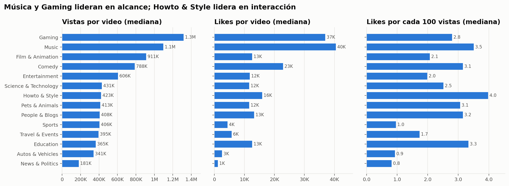

# Videos en tendencia de YouTube en Estados Unidos

Prueba práctica de ciencia de datos. Una empresa va a lanzar su marca en Estados Unidos y quiere posicionar su canal de YouTube. Este análisis busca entender qué caracteriza a los videos en tendencia para orientar la estrategia de contenido y la eventual elección de sponsors.

## Preguntas que responde

1. ¿Qué categorías reciben más vistas y likes?
2. ¿Se pueden encontrar agrupaciones de videos?
3. ¿Qué atributos hacen que un video dure más o llegue más rápido a tendencia?
4. ¿Influye la fecha u hora de publicación?
5. ¿Se pueden predecir las vistas o los likes de un video?

## Resultados principales

Se analizaron 6.347 videos que estuvieron en tendencia entre noviembre de 2017 y junio de 2018.

| Pregunta | Respuesta |
|---|---|
| Categorías con más vistas y likes | **Gaming y Música** tienen el mayor alcance por video (más de 1 millón de vistas y cerca de 40 mil likes de mediana). **Entertainment** es la de mayor presencia (25% de la lista) y **Howto & Style** la de mayor interacción (4 likes por cada 100 vistas). |
| Agrupaciones de videos | Cinco segmentos de comportamiento con K-Means: grandes éxitos, comunidad fiel, medios recurrentes, polémicos y llegada lenta. Son estables, aunque sus fronteras no son nítidas (silueta de 0,18). |
| Qué hace que un video dure en tendencia | Quién lo publica y qué tipo de contenido es. Título, etiquetas y horario casi no influyen. El dataset solo contiene videos que ya llegaron a tendencia, así que no se puede modelar qué separa a los que llegan de los que no. |
| Influencia de la fecha de publicación | Poca. Los videos publicados en fin de semana tienen un 16% más de vistas que un video comparable; la hora no influye. No se puede medir estacionalidad anual con siete meses de datos. |
| Predicción de vistas y likes | Antes de publicar, solo de forma gruesa (R² de 0,21 en vistas, error típico de un factor de 2,2). Con los datos del primer día en tendencia, con precisión (R² de 0,85 en vistas y 0,95 en likes). |

Otros hallazgos:

- **El canal es el factor que más pesa.** Entre canales con dos o más videos, explica el 62% de la variación de las vistas.
- **La lista de tendencias cambia en marzo de 2018:** entra la mitad de videos nuevos, con más del triple de vistas y el doble de días en la lista. Todas las comparaciones se hacen dentro de cada periodo.
- **Pronóstico exploratorio:** un modelo SARIMA proyecta el nivel de la lista a 14 días con un error típico del 7,7%.



## Metodología

Se sigue CRISP-DM. Cada notebook cubre una etapa:

| Notebook | Etapa CRISP-DM | Contenido |
|---|---|---|
| `01_comprension_negocio_y_datos` | Comprensión del negocio y de los datos | Objetivos, calidad y estructura de los datos |
| `02_preparacion_datos` | Preparación | Limpieza, cruce con categorías, dataset a nivel video |
| `03_analisis_exploratorio` | Comprensión de los datos | Categorías, engagement, efecto de la fecha de publicación |
| `04_clustering` | Modelado | Segmentación de videos |
| `05_modelos_predictivos` | Modelado y evaluación | Predicción de vistas y likes, importancia de variables |
| `06_pronostico_tendencias` | Modelado y evaluación | Pronóstico exploratorio del nivel de la lista a 14 días |

## Entregables

- **Notebooks:** los seis de la tabla anterior, en `notebooks/`, ya ejecutados.

## Estructura

```
├── data/
│   ├── raw/          # datos originales de Kaggle
│   └── processed/    # datasets limpios generados por los notebooks
├── notebooks/        # análisis paso a paso
├── src/              # funciones compartidas de carga y limpieza
└── reports/          # figuras generadas por los notebooks
```

## Datos

Fuente: [Trending YouTube Video Statistics](https://www.kaggle.com/datasets/datasnaek/youtube-new) en Kaggle.

El CSV no se incluye en el repositorio por su tamaño. Para reproducir el análisis, descarga `USvideos.csv` de Kaggle y ponlo en `data/raw/`. El archivo `US_category_id.json` ya está incluido.

## Cómo ejecutar

```bash
pip install -r requirements.txt
```

```bash
jupyter lab
```

Los notebooks se ejecutan en orden numérico.
